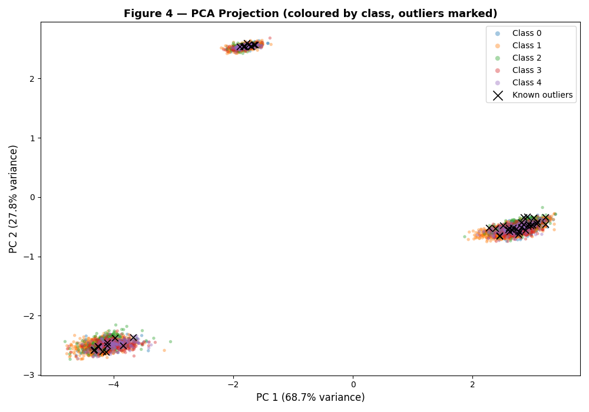

<a id="readme-top"></a>

[![Contributors][contributors-shield]][contributors-url]
[![Forks][forks-shield]][forks-url]
[![Stargazers][stars-shield]][stars-url]
[![Issues][issues-shield]][issues-url]
[![License][license-shield]][license-url]

<h3 align="center">Machine Learning 1 — Course Project 2026</h3>

<p align="center">
    Classification with outlier detection and model explainability on a 12-feature tabular dataset. Course project for Machine Learning 1 at TU Graz, summer term 2026.
    <br />
    <br />
    <a href="https://github.com/MarcyVibin/machine_learning_1_2026/issues">Report Bug</a>
    &middot;
    <a href="https://github.com/MarcyVibin/machine_learning_1_2026/issues">Request Feature</a>
</p>

<!-- TABLE OF CONTENTS -->
<details>
  <summary>Table of Contents</summary>
  <ol>
    <li>
      <a href="#about-the-project">About The Project</a>
      <ul>
        <li><a href="#repository-contents">Repository Contents</a></li>
        <li><a href="#built-with">Built With</a></li>
      </ul>
    </li>
    <li>
      <a href="#getting-started">Getting Started</a>
      <ul>
        <li><a href="#requirements">Requirements</a></li>
        <li><a href="#installation">Installation</a></li>
      </ul>
    </li>
    <li><a href="#usage">Usage</a></li>
    <li><a href="#license">License</a></li>
    <li><a href="#contact">Contact</a></li>
  </ol>
</details>

---

## About The Project

This is the code for the course project of Machine Learning 1 at TU Graz. The task is described in `ml1_assignment3.pdf`. The CSV files were provided by the lecture.

`code_skeleton.py` runs the whole pipeline:

- **Data analysis:** class distribution, per-class feature distributions, correlation heatmap, PCA and t-SNE projections
- **Model selection:** k selection for k-NN, then a comparison of several classifiers (k-NN, logistic regression, random forest, gradient boosting, MLP) by macro-F1 with cross-validation
- **Outlier detection:** a Gaussian mixture model whose components are chosen by BIC, used to flag test samples that do not belong to the training distribution
- **Explainability:** permutation importance, SHAP and LIME
- **Predictions:** one CSV for the leaderboard set and one for the final set



<p align="right">(<a href="#readme-top">back to top</a>)</p>

### Repository Contents

| File | Purpose |
| --- | --- |
| [code_skeleton.py](code_skeleton.py) | The full pipeline: analysis, models, outlier detection, explainability, submissions |
| [ml1_assignment3.pdf](ml1_assignment3.pdf) | The assignment sheet |
| `D.csv` | Labelled training data (`id`, `feature_0` … `feature_11`, `label`) |
| `D_out.csv` | Additional samples from outside the training distribution |
| `D_test_leaderboard.csv`, `D_test_final.csv` | Unlabelled test sets for the leaderboard and the final evaluation |
| `submission_*.csv` | Predictions written by the pipeline (`id`, `label`, `outlier`) |
| [img/](img/) | Plots saved by the pipeline |

<p align="right">(<a href="#readme-top">back to top</a>)</p>

### Built With

* [![Python][Python.org]][Python-url]
* [![scikit-learn][sklearn-badge]][sklearn-url]
* [![pandas][pandas-badge]][pandas-url]
* [![NumPy][NumPy-badge]][NumPy-url]
* [Matplotlib](https://matplotlib.org/), [seaborn](https://seaborn.pydata.org/), [SciPy](https://scipy.org/)
* [SHAP](https://github.com/shap/shap) and [LIME](https://github.com/marcotcr/lime)

<p align="right">(<a href="#readme-top">back to top</a>)</p>

---

## Getting Started

### Requirements

- Python 3.10+
- `pandas`, `numpy`, `scikit-learn`, `scipy`, `matplotlib`, `seaborn`, `shap`, `lime`

`requirements.txt` is currently empty, so install the packages above by hand.

### Installation

```sh
git clone https://github.com/MarcyVibin/machine_learning_1_2026.git
cd machine_learning_1_2026
pip install pandas numpy scikit-learn scipy matplotlib seaborn shap lime
```

---

## Usage

Run the pipeline from the repository folder, because the CSV files are read from the current directory:

```sh
python code_skeleton.py
```

The model, outlier and explainability plots are saved to `img/`, and the predictions are written to `submission_leaderboard_noClueForName.csv` and `submission_final_noClueForName.csv`. The data-analysis plots (class distribution, PCA, t-SNE …) are switched off in `main()`. Call `dataAnalysis(True, True)` there to show and save them. The t-SNE plot takes about a minute.

The assignment asks for the group name in the file name (`submission_leaderboard_GroupName.csv`), so rename the two outputs before you hand them in.

<p align="right">(<a href="#readme-top">back to top</a>)</p>

---

## License

Distributed under the GNU General Public License v3.0 (GPL-3.0). See `LICENSE` for more information.

---

## Contact

Marc Steger - marc.steger06@gmail.com

Project Link: https://github.com/MarcyVibin/machine_learning_1_2026

<p align="right">(<a href="#readme-top">back to top</a>)</p>

<!-- Badge Links -->

[Python.org]: https://img.shields.io/badge/Python-3.10+-3776AB?style=for-the-badge&logo=python&logoColor=white
[Python-url]: https://www.python.org/

[sklearn-badge]: https://img.shields.io/badge/scikit--learn-F7931E?style=for-the-badge&logo=scikitlearn&logoColor=white
[sklearn-url]: https://scikit-learn.org/

[pandas-badge]: https://img.shields.io/badge/pandas-150458?style=for-the-badge&logo=pandas&logoColor=white
[pandas-url]: https://pandas.pydata.org/

[NumPy-badge]: https://img.shields.io/badge/NumPy-013243?style=for-the-badge&logo=numpy&logoColor=white
[NumPy-url]: https://numpy.org/

[contributors-shield]: https://img.shields.io/github/contributors/MarcyVibin/machine_learning_1_2026.svg?style=for-the-badge
[contributors-url]: https://github.com/MarcyVibin/machine_learning_1_2026/graphs/contributors

[forks-shield]: https://img.shields.io/github/forks/MarcyVibin/machine_learning_1_2026.svg?style=for-the-badge
[forks-url]: https://github.com/MarcyVibin/machine_learning_1_2026/network/members

[stars-shield]: https://img.shields.io/github/stars/MarcyVibin/machine_learning_1_2026.svg?style=for-the-badge
[stars-url]: https://github.com/MarcyVibin/machine_learning_1_2026/stargazers

[issues-shield]: https://img.shields.io/github/issues/MarcyVibin/machine_learning_1_2026.svg?style=for-the-badge
[issues-url]: https://github.com/MarcyVibin/machine_learning_1_2026/issues

[license-shield]: https://img.shields.io/github/license/MarcyVibin/machine_learning_1_2026.svg?style=for-the-badge
[license-url]: https://github.com/MarcyVibin/machine_learning_1_2026/blob/main/LICENSE
